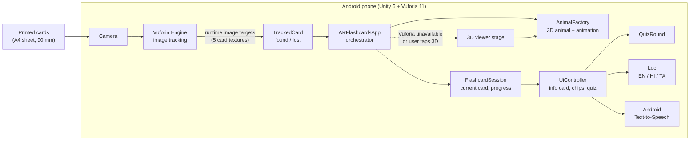

# AR Flashcards — Project Report

**Course:** AR / VR  **Student:** Aryan Gupta, B.Tech CSE (Sem 7), SRM Institute of Science and Technology
**Platform:** Unity 6 · Vuforia Engine 11.4 · Android

## 1. Abstract
Rote learning from printed flashcards is passive. AR Flashcards augments printed animal cards with an animated 3D model, the animal's name and a fact in English, Hindi or Tamil, a spoken read-out and a quiz. It runs on a single Android phone with no additional hardware, and degrades gracefully to a 3D viewer when AR tracking is unavailable.

## 2. Objectives
1. Recognise printed cards with marker-based AR (Vuforia image targets) and anchor 3D content to them.
2. Make content interactive: rotate, pinch-zoom, quiz, voice, language switch.
3. Require nothing beyond a phone and a printed A4 sheet.
4. Be robust: a clear status message and a 3D-viewer fallback instead of a blank screen.

## 3. System design

| Module | Responsibility |
|---|---|
| `VuforiaBridge`, `TrackedCard` | Only code touching Vuforia: creates image targets at runtime from the card textures, reports found/lost |
| `ARFlashcardsApp` | Orchestrates start-up, AR ⇄ 3D mode, fallbacks, watchdog timeout |
| `FlashcardSession` | Pure state: visible cards, newest-wins, progress counter (unit-tested) |
| `AnimalFactory`, `ProceduralAnimator` | Builds each animal from primitives; idle animation (breathing, head, tail, trunk) |
| `UiController`, `Ui` | IMGUI (OnGUI) UI, no package dependency: status pill, chips, info card, quiz, zoom buttons, toast, safe-area aware |
| `QuizRound` | Multiple-choice logic with shuffled options (unit-tested) |
| `Loc` | Language state and pre-shaped Hindi/Tamil text images |
| `PointerInput` | Touch/mouse input for both Unity input back-ends |
| Editor tools | Setup wizard (licence, scene, Android settings, build) and manifest post-processor for text-to-speech |

### Design decisions
- **Runtime image targets** (`ObserverFactory.CreateImageTarget(Texture2D, width, name)`) remove the Target Manager database step, a common source of setup errors.
- **Everything built from code**: no missing Inspector references.
- **Indic text as images**: Unity's built-in text cannot shape Devanagari/Tamil conjuncts, so strings are rendered offline with a shaping engine (HarfBuzz/Raqm) and shipped as textures.
- **Distinct cards**: each card has its own low-poly background, layout and text so features do not overlap between cards (measured: 13× separation).
- **Fallback-first**: any Vuforia failure (licence, camera, permission, timeout) selects the 3D viewer with a visible reason.

## 4. Implementation highlights
Tracking → `TrackedCard` → session → UI is event-driven. The model pops in with an ease-out-back animation; one finger rotates, two fingers scale; drags are only accepted in the central screen region so button presses never rotate the model. Android text-to-speech is accessed through `AndroidJavaObject`; a build post-processor adds the `<queries>` manifest entry Android 11+ requires.

## 5. Testing
63 automated tests plus compile checks (see `TEST_REPORT.md`). Device-level checklist in `SETUP_GUIDE.md`. *(Insert phone screenshots / demo video here after your first run.)*

## 6. Limitations and future work
Procedural models are stylised; real sounds and glTF models can be dropped in. Extended tracking / Ground Plane placement, more decks (planets, organs), cloud-recognition for large decks, saved quiz scores and a teacher dashboard are natural extensions.

## 7. References
Vuforia Engine Unity API reference (ObserverFactory, VuforiaApplication) · Unity 6 documentation (uGUI, Input System, Android build) · Android TextToSpeech API.
